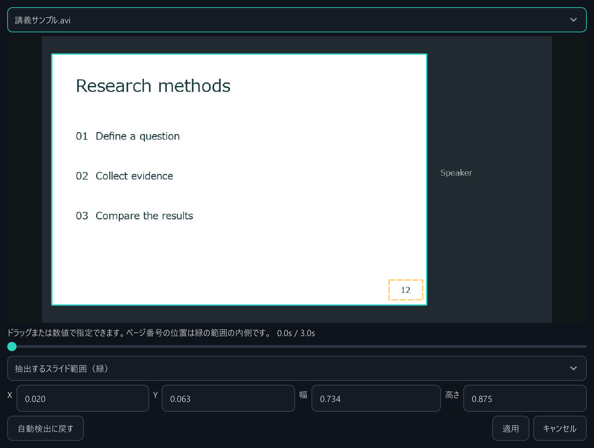

<p align="center">
  
</p>

<h1 align="center">Lectavo</h1>

<p align="center">Turn lecture videos into slide PDFs, transcripts, and lecture notes. A free Windows desktop app.</p>

<p align="center"><a href="https://lectavo.vercel.app"><strong>Website</strong></a> ・ <a href="https://github.com/Kou-256/Lectavo/releases/latest"><strong>Download latest release</strong></a> ・ <a href="README.md">日本語</a> ・ English</p>

## New in 0.4.0

- **Checkpoints and resume**: completed slide analysis and transcripts are saved. After the app closes, an error, or a cancellation, use Resume on Home or "Resume from where it stopped" on the error screen to run only the remaining work. A failed transcription is retried without repeating slide analysis. Saved data can be reviewed and deleted in Settings; data unused for 14 days is removed automatically.
- **Pre-run check**: before starting, Lectavo checks input files, audio and video tracks, free space in the output and temporary folders, whether the transcription model is ready, and GPU availability. A clean check starts immediately; otherwise the notes are shown first.
- **Review slides**: after processing, review the extracted slides, remove unwanted pages, drag to reorder, and add missed scenes from the video. "Finalize PDF" rebuilds the PDF and lecture notes; removed images go to the Recycle Bin.
- Videos without an audio track now skip transcription with a warning instead of failing.
- Home shows a four-step getting-started guide with new icons.
- Download `Lectavo-setup-0.4.0-x64.exe`. The legacy `Lectavo-Setup.exe` asset remains as a compatibility alias for older updaters.


## New in 0.3.1

- Fixed collapsed hero text on 4K displays.
- Separate Home and Process screens, with a resizable left file-tab list. Ctrl/Shift select multiple files; selected files can be removed together. Processing settings apply to the entire batch.
- Distinguish silent audio, no detected speech, and model-loading errors. Unreadable models are repaired into regular local files or downloaded again without deleting the original cache.
- All-failed audio batches no longer generate misleading empty notes.
- Download `Lectavo-setup-0.3.1-x64.exe`. The legacy `Lectavo-Setup.exe` asset remains as a compatibility alias for older updaters.


## New in 0.3.0

- Transcribe MP3, M4A, and WAV into TXT, SRT, and Markdown. Mix video and audio inputs, or process audio alone without slide detection. Combined SRT offsets include the complete audio duration, including silence.
- Select the slide crop and page-number area directly on a video preview. Seek to another frame, drag rectangles, or enter normalized coordinates. The green region determines the saved image; the yellow region is relative to it. Restore automatic detection at any time. A region applies to all selected videos, so process different layouts separately.
- Check for stable GitHub releases in the background. Download only after approval, validate the SHA-256 and size, then ask again before starting the installer. Cancel downloads or disable startup checks in Settings. Installation waits for active processing to finish. Versions 0.2.x require one manual upgrade to enable future in-app update checks.
- Start faster by deferring scientific libraries and GPU checks. Repeated launches activate the existing window. SVG icons identify navigation items.



Settings dropdowns and numeric inputs ignore mouse-wheel value changes, preventing accidental edits while scrolling. Use clicks, keyboard controls, or direct numeric entry to change settings.

Scrolling also leaves keyboard focus unchanged. Under **File names**, choose original names, the common part of video names, or a custom name, then optionally append a date or timestamp. A preview shows the resulting PDF and transcript names. The same base name applies to PDF, TXT, SRT, and Markdown; combined images and Markdown links stay aligned. Per-video custom names retain the source name for distinction. Naming preferences are saved. To keep separate runs, append a timestamp; reusing a name updates the existing outputs.

CLI examples: `--name-mode common --name-date datetime` or `--name-mode custom --output-name "Lecture notes"`.

GUI and CLI default to the common video name with a timestamp. The old GUI defaults are migrated once; subsequent choices are preserved. Use `--name-mode original --name-date none` for legacy CLI filenames.

Lectavo is a Windows desktop application that turns lecture and presentation videos into deduplicated slide PDFs, timestamped transcripts, SRT subtitles, and slide-aligned Markdown lecture notes.


## Highlights

- File, folder, and drag-and-drop input for MP4, MOV, MKV, AVI, WEBM, and M4V
- Slide-change detection with OpenCV, SSIM, and perceptual hashes
- Filtering for laser pointers, mouse cursors, and other small local changes
- Page-number-region and whole-slide change detection
- Natural filename ordering across multiple videos
- Combined PDF, transcript, SRT, and lecture notes with cross-video duplicate removal
- Optional per-video output mode
- Japanese, English, and automatic language detection with faster-whisper
- Optional CUDA acceleration with automatic CPU fallback
- Japanese and English UI, processing history, cancellation, detailed logs, and light/dark/system themes


## Download

Download `Lectavo-setup-0.4.0-x64.exe` from the [latest GitHub Release](https://github.com/Kou-256/Lectavo/releases/latest). The installed application does not require Python, pip, Git, a virtual environment, or a separate `ffmpeg.exe`.

- Windows 10 / 11 x64
- Japanese UI by default
- Automatic speech-language detection by default
- faster-whisper `small` model by default
- GPU optional; CPU-only operation is supported
- Desktop shortcut enabled by default

The current `0.4.0` binary is unsigned, so Windows SmartScreen may display a warning. Compare the download with the SHA-256 value attached to the release.

## Basic use

1. Run `Lectavo-setup-0.4.0-x64.exe`.
2. Launch Lectavo from the desktop or Start Menu.
3. Add videos with the file button, folder link, or drag and drop.
4. Choose combined output or per-video output.
5. Confirm output items, destination, quality, and CPU/GPU selection, then start processing.

The selected Whisper model is downloaded on the first transcription and cached under `%LOCALAPPDATA%\Lectavo\Cache`.

## Output

Combined mode creates one output set and removes duplicate slides across all selected videos:

```text
Lectavo_output/
  slides/
  all_slides.pdf
  all_transcript.txt
  all_transcript.srt
  all_lecture_notes.md
```

Per-video mode creates a separate directory for each input video.

## How slide detection works

Lectavo samples frames at a configurable interval. It combines grayscale difference area, connected components, SSIM, and a page-number region to identify slide changes. Candidates are compared with every previously accepted slide using pHash and SSIM, which removes back-navigation duplicates and repeated slides across videos.

## Transcription and GPU support

Lectavo uses [faster-whisper](https://github.com/SYSTRAN/faster-whisper). PyAV decodes media directly, so the application does not launch an external `ffmpeg.exe`.

When CUDA is selected, Lectavo diagnoses the required NVIDIA runtime before transcription. If the GPU or DLLs are unavailable, it records the reason, tells the user that it continued on CPU, and switches to CPU `int8`.

## Privacy

Lectavo does not upload input videos, generated slides, PDFs, transcripts, or lecture notes to a Lectavo server. It connects to Hugging Face only when a selected Whisper model must be downloaded.

## Development

The locally verified Python version is recorded in `.python-version`.

```powershell
py -3.14 -m venv movie_slide_notes\.venv
.\movie_slide_notes\.venv\Scripts\python.exe -m pip install -U pip
.\movie_slide_notes\.venv\Scripts\python.exe -m pip install -r requirements-dev.txt
.\movie_slide_notes\.venv\Scripts\python.exe app.py
```

CLI example:

```powershell
.\movie_slide_notes\.venv\Scripts\python.exe movie_slide_notes\main.py `
  --input "C:\Lectavo Demo\videos" `
  --output "C:\Lectavo Demo\output" `
  --language auto `
  --model small `
  --device cpu
```

Checks:

```powershell
$env:QT_QPA_PLATFORM = "offscreen"
.\movie_slide_notes\.venv\Scripts\python.exe -m ruff format --check movie_slide_notes tests app.py
.\movie_slide_notes\.venv\Scripts\python.exe -m ruff check movie_slide_notes tests app.py
.\movie_slide_notes\.venv\Scripts\python.exe -m unittest discover -s tests -v
.\scripts\audit_public_release.ps1
```

## Windows packaging

Lectavo uses PyInstaller `onedir` and Inno Setup:

```powershell
.\scripts\build_release.ps1
```

The release workflow creates `Lectavo-Setup.exe`, a portable ZIP, checksums, a version file, and release notes. Never commit signing certificates. See [PUBLIC_RELEASE_CHECKLIST.md](PUBLIC_RELEASE_CHECKLIST.md) for verified and outstanding distribution checks.

## Known limitations

- Heavily animated slides can produce extra captures.
- Frequent camera/slide layout switching can require sensitivity tuning.
- Extremely similar consecutive pages can require duplicate-threshold tuning.
- Windows ARM64 is not verified.
- Authenticode signing and clean Windows VM validation are not complete.

## Contributing and security

See [CONTRIBUTING.md](CONTRIBUTING.md) for development guidance and [SECURITY.md](SECURITY.md) for vulnerability reports.

## License

Lectavo source code is licensed under the [MIT License](LICENSE). Third-party components retain their own licenses. Read [THIRD_PARTY_NOTICES.txt](THIRD_PARTY_NOTICES.txt) and `licenses/`, especially the terms for Qt, PyAV, OpenCV, and the FFmpeg libraries distributed with binary wheels.
