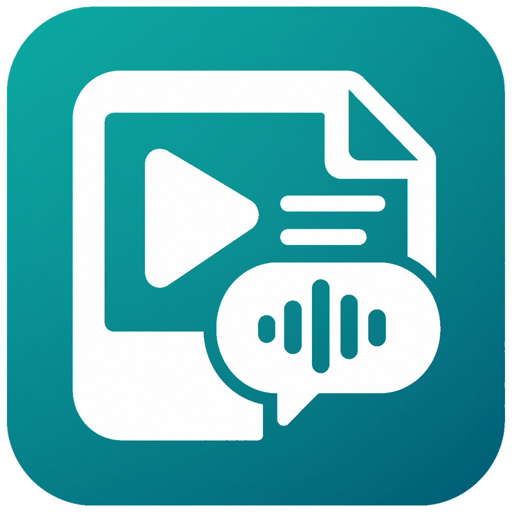
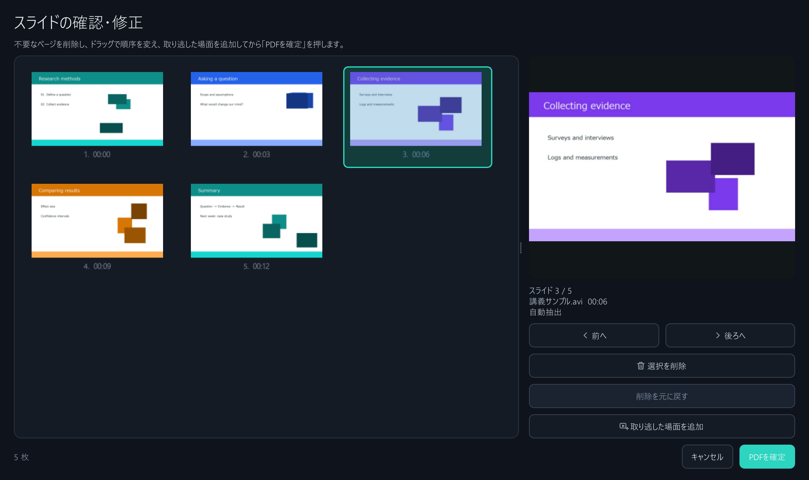
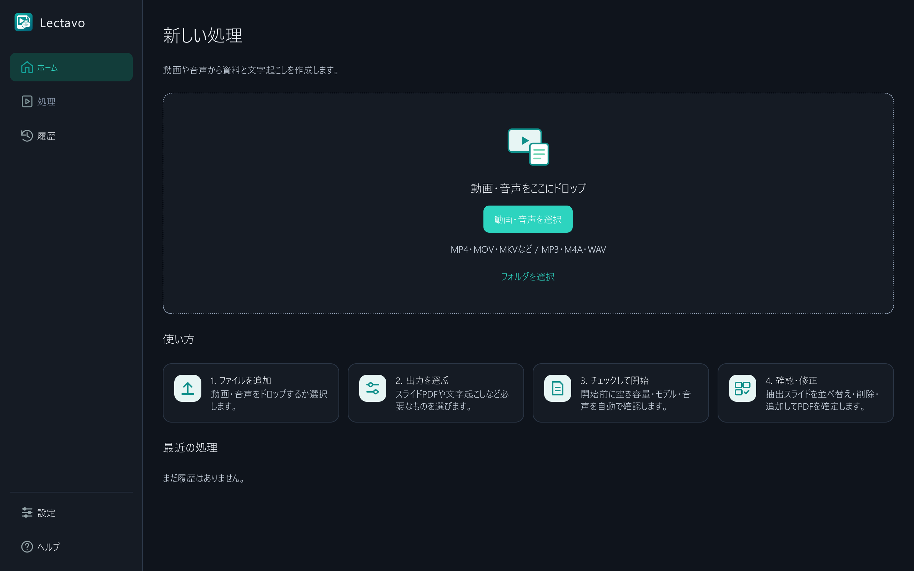
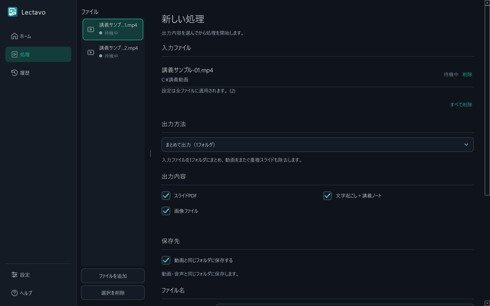

<p align="center">
  
</p>

<h1 align="center">Lectavo</h1>

<p align="center">Turn lecture videos into slide PDFs, transcripts, and lecture notes. A free Windows desktop app.</p>

<p align="center"><a href="https://lectavo.vercel.app"><strong>Website</strong></a> ・ <a href="https://github.com/Kou-256/Lectavo/releases/latest"><strong>Download latest release</strong></a> ・ <a href="README.md">日本語</a> ・ English</p>

## New in 0.5.4

- **Edit translated PDFs**: from the done screen or the comparison view, rewrite, move and resize translations; cut out, move, resize, delete or replace figures; add text and images; and erase areas. Saving writes the translated and bilingual PDFs again.
- **Select and copy text in the comparison view**: drag to select and press Ctrl+C. Selections can span pages and follow the reading order of two-column pages; the original text hidden under a translation is not selected.
- Download `Lectavo-setup-0.5.4-x64.exe`.

## New in 0.5.3

- **PDF list and preview**: the PDFs to translate are listed as with videos. Add or remove PDFs, and preview the pages of the one you click.
- **No more missing paragraphs**: headings at the top or in the middle of a paragraph are translated separately, and a paragraph the engine drops is translated again automatically.
- Fixed an unrelated heading (such as "2. Experimental methods") being added to the start of paragraphs.

## New in 0.5.2

- **Translate several PDFs at once**: pick multiple PDFs and translate them in parallel, as with video analysis.
- **Equations are kept as is**: formulas are left untranslated so the layout stays intact.
- **Subscripts and superscripts are kept**: Eu<sub>2</sub>O<sub>3</sub>, Eu<sup>3+</sup>, μ(x), and citation marks are drawn small and raised or lowered in the translation.
- Fixed translated text overlapping the next paragraph.
- **Comparison view**: all pages scroll continuously and smoothly; with "Sync scrolling" off, each side scrolls on its own.
- Fixed a clipped checkbox on the installer's finish page.

## New in 0.5.1

- **More accurate PDF translation**: pages embedded as a single graphic, such as journal cover pages, are now translated. Reference lists stay in the original language so the layout is kept.
- When a translation lands on the wrong paragraph, that paragraph is translated again automatically. Personal names and dates are kept as written.
- **Gemma 4 12B is the default built-in model**: until it is downloaded, a model already on your PC is used.
- **Comparison view**: scrolling past the end of a page moves to the next (or previous) page; the page number box no longer has up/down arrows.
- The installer's desktop and Start Menu shortcut boxes are checked on every update.

## New in 0.5.0

- **PDF translation**: translate PDFs while keeping figures, equations, and columns in place. Save the translated PDF and a bilingual PDF with the original and the translation side by side.
- **17 languages**: Japanese, English, Chinese (Simplified and Traditional), Korean, Spanish, French, German, and more. The source language can be detected automatically.
- **Three styles**: natural, literal, and plain language (やさしい日本語 for Japanese).
- **OCR for scans**: pages without a text layer are read with the bundled OCR first (Japanese, English, Chinese).
- **Built-in local LLM (default)**: download a model (Gemma 4 / Qwen3, 2.5–7.2 GB) in Settings and translate offline, for free, on your PC, using the GPU when available. Claude, OpenAI, Gemini, DeepL, and Ollama / LM Studio are also available.
- **Compare full screen**: view the original and the translation side by side with zoom, synchronized scrolling, and full screen.
- A new splash screen and Home screen.

## New in 0.4.5

- **Startup feels faster**: a small splash appears right after launch. In our measurements the time from clicking to seeing something dropped from about 1.2 s to about 0.6 s (it varies by PC).
- Less work at startup when the UI is Japanese, and the settings screen does less when it first loads.
- **Installer checkboxes**: fixed the clipped checkboxes on the "Select Additional Tasks" page.

## New in 0.4.4

- **Save next to the input** (on by default): results go into the input video's own folder, beside each video for per-video output or beside the first video for combined output. Turn it off to pick a folder as before.
- Settings and the Process screen line every field up in one label and field column, including "Select detection area visually".
- Expanding "スライド検出の詳細" or "開発者向け" no longer flickers; sections open and close smoothly.

## New in 0.4.3

- **Frame stepping in the crop dialog**: new −1s, −1 frame, +1 frame, and +1s buttons. Use ←/→ to move one frame and Shift+←/→ to move one second.
- The time is shown to a hundredth of a second with the frame number, and the exact frame is loaded, so change points can be placed right where the layout switches.


## New in 0.4.2

- **Crop by time**: when the screen layout changes mid-video, press "Change crop from this time" in the crop dialog to use a different crop from that point on. Timelines are saved per video; other videos use the shared crop.
- **No page numbers**: turn this on in Settings or the crop dialog for slides without page numbers, so page-number changes don't count as new slides.
- The crop dialog can be maximized.
- Combined output goes into one folder per run, named after the output name, with the PDF, TXT, SRT, MD, and slide images inside.
- The installer no longer shows an image in the top-right corner.

## New in 0.4.1

- The installer shows Lectavo artwork instead of Inno Setup's default box-and-disc images.
- The sidebar shows the app icon, and the active item's icon is highlighted.
- Input files on the Process screen are fixed-height rows with a type icon, an elided name, and a colored status.
- Thinner separators, aligned settings labels, and chevron icons for expandable sections.

## New in 0.4.0

- **Checkpoints and resume**: completed slide analysis and transcripts are saved. After the app closes, an error, or a cancellation, use Resume on Home or "Resume from where it stopped" on the error screen to run only the remaining work. A failed transcription is retried without repeating slide analysis. Saved data can be reviewed and deleted in Settings; data unused for 14 days is removed automatically.
- **Pre-run check**: before starting, Lectavo checks input files, audio and video tracks, free space in the output and temporary folders, whether the transcription model is ready, and GPU availability. A clean check starts immediately; otherwise the notes are shown first.
- **Review slides**: after processing, review the extracted slides, remove unwanted pages, drag to reorder, and add missed scenes from the video. "Finalize PDF" rebuilds the PDF and lecture notes; removed images go to the Recycle Bin.
- Videos without an audio track now skip transcription with a warning instead of failing.
- Home shows a four-step getting-started guide with new icons.
- The legacy `Lectavo-Setup.exe` asset remains as a compatibility alias for older updaters.



## New in 0.3.1

- Fixed collapsed hero text on 4K displays.
- Separate Home and Process screens, with a resizable left file-tab list. Ctrl/Shift select multiple files; selected files can be removed together. Processing settings apply to the entire batch.
- Distinguish silent audio, no detected speech, and model-loading errors. Unreadable models are repaired into regular local files or downloaded again without deleting the original cache.
- All-failed audio batches no longer generate misleading empty notes.
- Download `Lectavo-setup-0.3.1-x64.exe`. The legacy `Lectavo-Setup.exe` asset remains as a compatibility alias for older updaters.


## New in 0.3.0

- Transcribe MP3, M4A, and WAV into TXT, SRT, and Markdown. Mix video and audio inputs, or process audio alone without slide detection. Combined SRT offsets include the complete audio duration, including silence.
- Select the slide crop and page-number area directly on a video preview. Seek to another frame, drag rectangles, or enter normalized coordinates. The green region determines the saved image; the yellow region is relative to it. Restore automatic detection at any time. A region applies to all selected videos, so process different layouts separately.
- Check for stable GitHub releases in the background. Download only after approval, validate the SHA-256 and size, then ask again before starting the installer. Cancel downloads or disable startup checks in Settings. Installation waits for active processing to finish. Versions 0.2.x require one manual upgrade to enable future in-app update checks.
- Start faster by deferring scientific libraries and GPU checks. Repeated launches activate the existing window. SVG icons identify navigation items.


Settings dropdowns and numeric inputs ignore mouse-wheel value changes, preventing accidental edits while scrolling. Use clicks, keyboard controls, or direct numeric entry to change settings.

Scrolling also leaves keyboard focus unchanged. Under **File names**, choose original names, the common part of video names, or a custom name, then optionally append a date or timestamp. A preview shows the resulting PDF and transcript names. The same base name applies to PDF, TXT, SRT, and Markdown; combined images and Markdown links stay aligned. Per-video custom names retain the source name for distinction. Naming preferences are saved. To keep separate runs, append a timestamp; reusing a name updates the existing outputs.

CLI examples: `--name-mode common --name-date datetime` or `--name-mode custom --output-name "Lecture notes"`.

GUI and CLI default to the common video name with a timestamp. The old GUI defaults are migrated once; subsequent choices are preserved. Use `--name-mode original --name-date none` for legacy CLI filenames.

Lectavo is a Windows desktop application that turns lecture and presentation videos into deduplicated slide PDFs, timestamped transcripts, SRT subtitles, and slide-aligned Markdown lecture notes.



## Highlights

- File, folder, and drag-and-drop input for MP4, MOV, MKV, AVI, WEBM, and M4V
- Slide-change detection with OpenCV, SSIM, and perceptual hashes
- Filtering for laser pointers, mouse cursors, and other small local changes
- Page-number-region and whole-slide change detection
- Natural filename ordering across multiple videos
- Combined PDF, transcript, SRT, and lecture notes with cross-video duplicate removal
- Optional per-video output mode
- Japanese, English, and automatic language detection with faster-whisper
- Optional CUDA acceleration with automatic CPU fallback
- Japanese and English UI, processing history, cancellation, detailed logs, and light/dark/system themes



- **PDF translation**: translate PDFs into 17 languages while keeping the layout, as a translated PDF and a side-by-side bilingual PDF.
- Three styles: natural, literal, and plain language (やさしい日本語 for Japanese). Figures, equations, and images stay as they are.
- A full-screen viewer shows the original and the translation side by side, with zoom and synchronized scrolling.
- Scanned PDFs are read with the bundled OCR (RapidOCR: Japanese, English, Chinese) before translating.
- **Built-in local LLM (default)**: download a model (Gemma 4 / Qwen3, 2.5–7.2 GB) in the app and translate offline, for free, on your PC. Uses the GPU via Vulkan when available.
- Or use Claude, OpenAI, Gemini, DeepL, or an external local LLM (Ollama / LM Studio). API keys are stored encrypted with Windows DPAPI.

## Download

Download `Lectavo-setup-0.5.4-x64.exe` from the [latest GitHub Release](https://github.com/Kou-256/Lectavo/releases/latest). The installed application does not require Python, pip, Git, a virtual environment, or a separate `ffmpeg.exe`.

- Windows 10 / 11 x64
- Japanese UI by default
- Automatic speech-language detection by default
- faster-whisper `small` model by default
- GPU optional; CPU-only operation is supported
- Desktop and Start Menu shortcuts enabled by default (checked again on every update)

The current `0.5.4` binary is self-signed (publisher "Lectavo / Kou Hashizume"). Because the certificate is not from a trusted authority, Windows SmartScreen or an "unknown publisher" prompt may still appear. Compare the download with the SHA-256 value attached to the release.

## Basic use

1. Run `Lectavo-setup-0.5.4-x64.exe`.
2. Launch Lectavo from the desktop or Start Menu.
3. Add videos with the file button, folder link, or drag and drop.
4. Choose combined output or per-video output.
5. Confirm output items, destination, quality, and CPU/GPU selection, then start processing.

The selected Whisper model is downloaded on the first transcription and cached under `%LOCALAPPDATA%\Lectavo\Cache`.

## Output

Combined mode creates one output set and removes duplicate slides across all selected videos:

```text
Lectavo_output/
  slides/
  all_slides.pdf
  all_transcript.txt
  all_transcript.srt
  all_lecture_notes.md
```

Per-video mode creates a separate directory for each input video.

## How slide detection works

Lectavo samples frames at a configurable interval. It combines grayscale difference area, connected components, SSIM, and a page-number region to identify slide changes. Candidates are compared with every previously accepted slide using pHash and SSIM, which removes back-navigation duplicates and repeated slides across videos.

## Transcription and GPU support

Lectavo uses [faster-whisper](https://github.com/SYSTRAN/faster-whisper). PyAV decodes media directly, so the application does not launch an external `ffmpeg.exe`.

When CUDA is selected, Lectavo diagnoses the required NVIDIA runtime before transcription. If the GPU or DLLs are unavailable, it records the reason, tells the user that it continued on CPU, and switches to CPU `int8`.

## Privacy

Lectavo does not upload input videos, generated slides, PDFs, transcripts, or lecture notes to a Lectavo server. It connects to Hugging Face only when a selected Whisper model must be downloaded.

## Development

The locally verified Python version is recorded in `.python-version`.

```powershell
py -3.14 -m venv movie_slide_notes\.venv
.\movie_slide_notes\.venv\Scripts\python.exe -m pip install -U pip
.\movie_slide_notes\.venv\Scripts\python.exe -m pip install -r requirements-dev.txt
.\movie_slide_notes\.venv\Scripts\python.exe app.py
```

CLI example:

```powershell
.\movie_slide_notes\.venv\Scripts\python.exe movie_slide_notes\main.py `
  --input "C:\Lectavo Demo\videos" `
  --output "C:\Lectavo Demo\output" `
  --language auto `
  --model small `
  --device cpu
```

Checks:

```powershell
$env:QT_QPA_PLATFORM = "offscreen"
.\movie_slide_notes\.venv\Scripts\python.exe -m ruff format --check movie_slide_notes tests app.py
.\movie_slide_notes\.venv\Scripts\python.exe -m ruff check movie_slide_notes tests app.py
.\movie_slide_notes\.venv\Scripts\python.exe -m unittest discover -s tests -v
.\scripts\audit_public_release.ps1
```

## Windows packaging

Lectavo uses PyInstaller `onedir` and Inno Setup:

```powershell
.\scripts\build_release.ps1
```

The release workflow creates `Lectavo-Setup.exe`, a portable ZIP, checksums, a version file, and release notes. Never commit signing certificates. See [PUBLIC_RELEASE_CHECKLIST.md](PUBLIC_RELEASE_CHECKLIST.md) for verified and outstanding distribution checks.

## Known limitations

- Heavily animated slides can produce extra captures.
- Frequent camera/slide layout switching can require sensitivity tuning.
- Extremely similar consecutive pages can require duplicate-threshold tuning.
- Windows ARM64 is not verified.
- Authenticode signing and clean Windows VM validation are not complete.

## Contributing and security

See [CONTRIBUTING.md](CONTRIBUTING.md) for development guidance and [SECURITY.md](SECURITY.md) for vulnerability reports.

## License

Lectavo source code is licensed under the [MIT License](LICENSE). Third-party components retain their own licenses. Read [THIRD_PARTY_NOTICES.txt](THIRD_PARTY_NOTICES.txt) and `licenses/`, especially the terms for Qt, PyAV, OpenCV, and the FFmpeg libraries distributed with binary wheels.
