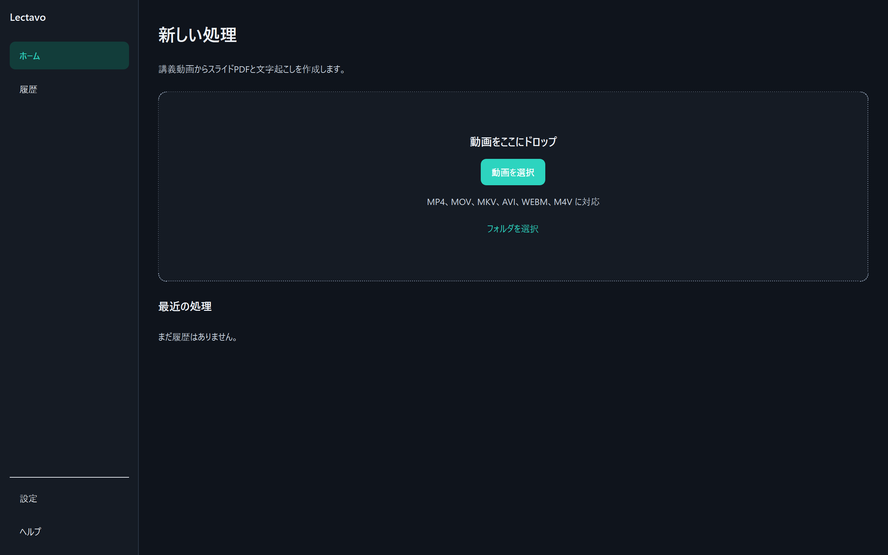
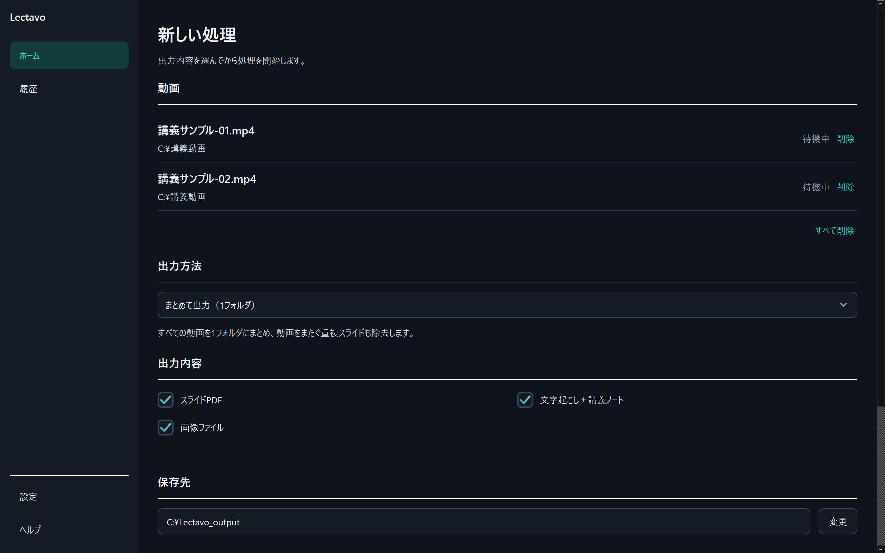

# Lectavo

Settings dropdowns and numeric inputs ignore mouse-wheel value changes, preventing accidental edits while scrolling. Use clicks, keyboard controls, or direct numeric entry to change settings.

Scrolling also leaves keyboard focus unchanged. Under **File names**, choose original names, the common part of video names, or a custom name, then optionally append a date or timestamp. A preview shows the resulting PDF and transcript names. The same base name applies to PDF, TXT, SRT, and Markdown; combined images and Markdown links stay aligned. Per-video custom names retain the source name for distinction. Naming preferences are saved. To keep separate runs, append a timestamp; reusing a name updates the existing outputs.

CLI examples: `--name-mode common --name-date datetime` or `--name-mode custom --output-name "Lecture notes"`.

[日本語](README.md) | [English](README.en.md) | [Website](https://lectavo.vercel.app) | [Download latest release](https://github.com/Kou-256/Lectavo/releases/latest)

Lectavo is a Windows desktop application that turns lecture and presentation videos into deduplicated slide PDFs, timestamped transcripts, SRT subtitles, and slide-aligned Markdown lecture notes.



## Highlights

- File, folder, and drag-and-drop input for MP4, MOV, MKV, AVI, WEBM, and M4V
- Slide-change detection with OpenCV, SSIM, and perceptual hashes
- Filtering for laser pointers, mouse cursors, and other small local changes
- Page-number-region and whole-slide change detection
- Natural filename ordering across multiple videos
- Combined PDF, transcript, SRT, and lecture notes with cross-video duplicate removal
- Optional per-video output mode
- Japanese, English, and automatic language detection with faster-whisper
- Optional CUDA acceleration with automatic CPU fallback
- Japanese and English UI, processing history, cancellation, detailed logs, and light/dark/system themes



## Download

Download `Lectavo-Setup.exe` from the [latest GitHub Release](https://github.com/Kou-256/Lectavo/releases/latest). The installed application does not require Python, pip, Git, a virtual environment, or a separate `ffmpeg.exe`.

- Windows 10 / 11 x64
- Japanese UI by default
- Automatic speech-language detection by default
- faster-whisper `small` model by default
- GPU optional; CPU-only operation is supported
- Desktop shortcut enabled by default

The current `0.2.1` binary is unsigned, so Windows SmartScreen may display a warning. Compare the download with the SHA-256 value attached to the release.

## Basic use

1. Run `Lectavo-Setup.exe`.
2. Launch Lectavo from the desktop or Start Menu.
3. Add videos with the file button, folder link, or drag and drop.
4. Choose combined output or per-video output.
5. Confirm output items, destination, quality, and CPU/GPU selection, then start processing.

The selected Whisper model is downloaded on the first transcription and cached under `%LOCALAPPDATA%\Lectavo\Cache`.

## Output

Combined mode creates one output set and removes duplicate slides across all selected videos:

```text
Lectavo_output/
  slides/
  all_slides.pdf
  all_transcript.txt
  all_transcript.srt
  all_lecture_notes.md
```

Per-video mode creates a separate directory for each input video.

## How slide detection works

Lectavo samples frames at a configurable interval. It combines grayscale difference area, connected components, SSIM, and a page-number region to identify slide changes. Candidates are compared with every previously accepted slide using pHash and SSIM, which removes back-navigation duplicates and repeated slides across videos.

## Transcription and GPU support

Lectavo uses [faster-whisper](https://github.com/SYSTRAN/faster-whisper). PyAV decodes media directly, so the application does not launch an external `ffmpeg.exe`.

When CUDA is selected, Lectavo diagnoses the required NVIDIA runtime before transcription. If the GPU or DLLs are unavailable, it records the reason, tells the user that it continued on CPU, and switches to CPU `int8`.

## Privacy

Lectavo does not upload input videos, generated slides, PDFs, transcripts, or lecture notes to a Lectavo server. It connects to Hugging Face only when a selected Whisper model must be downloaded.

## Development

The locally verified Python version is recorded in `.python-version`.

```powershell
py -3.14 -m venv movie_slide_notes\.venv
.\movie_slide_notes\.venv\Scripts\python.exe -m pip install -U pip
.\movie_slide_notes\.venv\Scripts\python.exe -m pip install -r requirements-dev.txt
.\movie_slide_notes\.venv\Scripts\python.exe app.py
```

CLI example:

```powershell
.\movie_slide_notes\.venv\Scripts\python.exe movie_slide_notes\main.py `
  --input "C:\Lectavo Demo\videos" `
  --output "C:\Lectavo Demo\output" `
  --language auto `
  --model small `
  --device cpu
```

Checks:

```powershell
$env:QT_QPA_PLATFORM = "offscreen"
.\movie_slide_notes\.venv\Scripts\python.exe -m ruff format --check movie_slide_notes tests app.py
.\movie_slide_notes\.venv\Scripts\python.exe -m ruff check movie_slide_notes tests app.py
.\movie_slide_notes\.venv\Scripts\python.exe -m unittest discover -s tests -v
.\scripts\audit_public_release.ps1
```

## Windows packaging

Lectavo uses PyInstaller `onedir` and Inno Setup:

```powershell
.\scripts\build_release.ps1
```

The release workflow creates `Lectavo-Setup.exe`, a portable ZIP, checksums, a version file, and release notes. Never commit signing certificates. See [PUBLIC_RELEASE_CHECKLIST.md](PUBLIC_RELEASE_CHECKLIST.md) for verified and outstanding distribution checks.

## Known limitations

- Heavily animated slides can produce extra captures.
- Frequent camera/slide layout switching can require sensitivity tuning.
- Extremely similar consecutive pages can require duplicate-threshold tuning.
- Windows ARM64 is not verified.
- Authenticode signing and clean Windows VM validation are not complete.

## Contributing and security

See [CONTRIBUTING.md](CONTRIBUTING.md) for development guidance and [SECURITY.md](SECURITY.md) for vulnerability reports.

## License

Lectavo source code is licensed under the [MIT License](LICENSE). Third-party components retain their own licenses. Read [THIRD_PARTY_NOTICES.txt](THIRD_PARTY_NOTICES.txt) and `licenses/`, especially the terms for Qt, PyAV, OpenCV, and the FFmpeg libraries distributed with binary wheels.
