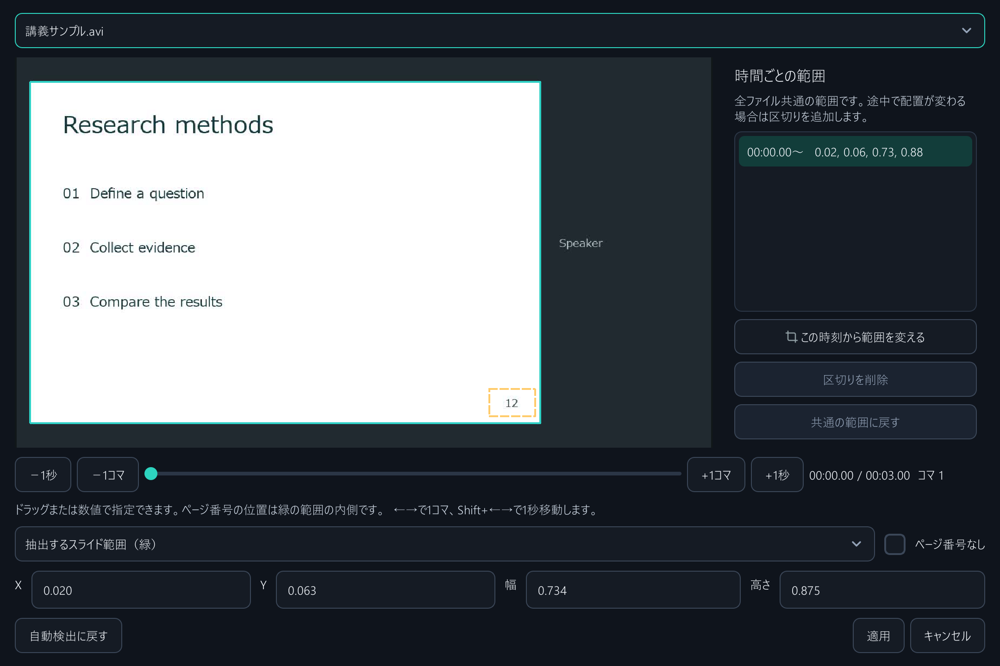
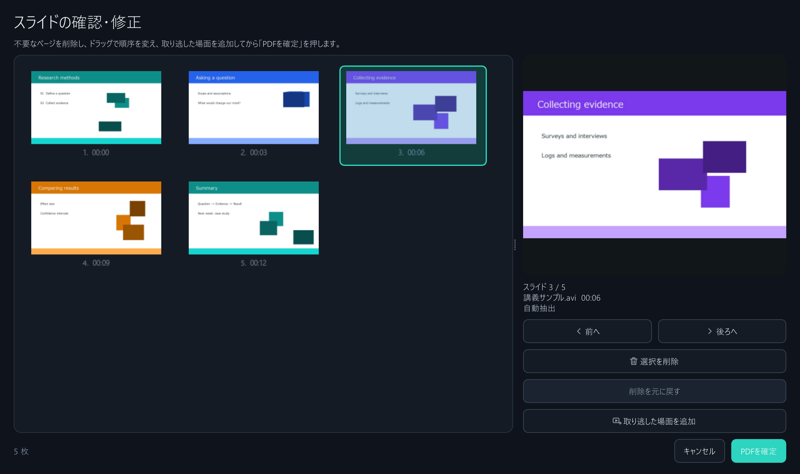
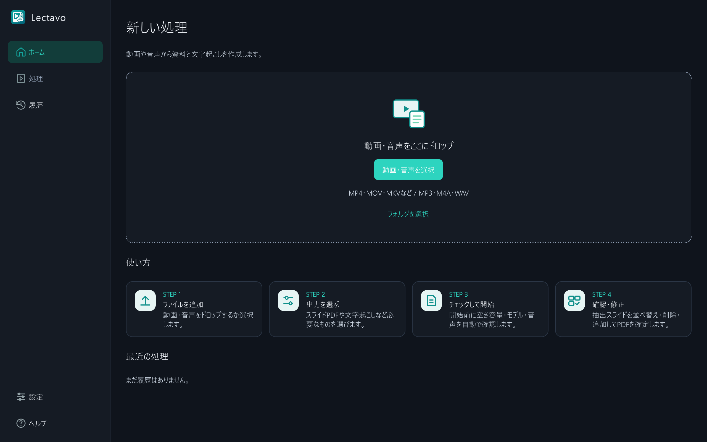
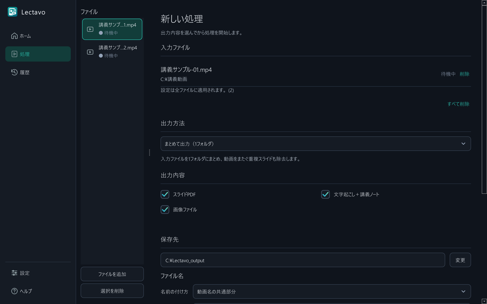
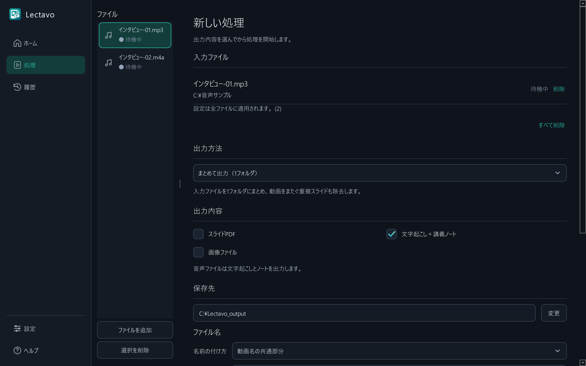

<p align="center">
  
</p>

<h1 align="center">Lectavo</h1>

<p align="center">講義動画を、スライドPDF・文字起こし・講義ノートへ。Windows向けの無料デスクトップアプリ。</p>

<p align="center"><a href="https://lectavo.vercel.app"><strong>公式サイト</strong></a> ・ <a href="https://github.com/Kou-256/Lectavo/releases/latest"><strong>最新版をダウンロード</strong></a> ・ 日本語 ・ <a href="README.en.md">English</a></p>

## 0.4.3 の改善

- **範囲指定のコマ送り**: 範囲指定画面に「−1秒」「−1コマ」「+1コマ」「+1秒」ボタンを追加しました。キーボードの ←→ で1コマ、Shift+←→ で1秒移動できます。
- 時刻は 0.01 秒単位とコマ番号で表示し、指定した時刻のフレームを正確に読み込みます。配置が切り替わる瞬間に合わせて区切りを追加できます。
- 配布ファイル名は `Lectavo-setup-0.4.3-x64.exe` です。



## 0.4.2 の新機能

- **時間ごとの検出範囲**: 動画の途中で画面の配置が変わる場合に、範囲指定画面で「この時刻から範囲を変える」を押すと、その時刻以降に別の範囲を使えます。設定は動画ごとに保存され、設定していない動画は共通の範囲を使います。
- **ページ番号なし**: スライドにページ番号がない場合は、設定画面または範囲指定画面でオンにすると、ページ番号の変化では切り替わりを判定しません。
- 範囲指定画面を最大化できるようになりました。
- 「まとめて出力」では、処理ごとに出力名のフォルダを作り、PDF・TXT・SRT・MD・スライド画像をその中に保存します。
- インストーラーの右上の画像を表示しないようにしました。

## 0.4.1 の改善

- インストーラーの画像を、Inno Setup既定の箱とディスクの絵からLectavoのデザインに変更しました。
- サイドバーにアプリアイコンを表示し、選択中のメニューのアイコンも強調表示します。
- 処理画面のファイル一覧を、種類アイコン・省略表示の名前・色分けした状態で同じ高さにそろえました。
- 区切り線を細く控えめにし、設定画面の項目名の位置をそろえ、展開ボタンを矢印アイコンにしました。

## 0.4.0 の新機能

- **途中保存・処理再開**: 完了したスライド解析と文字起こしを保存します。アプリの終了やエラー、キャンセルのあとも、ホームの「続きから再開」やエラー画面の「続きから再実行」で、残りの処理だけを行えます。文字起こしだけ失敗した場合は、スライド解析をやり直しません。保存データは設定画面で確認・削除でき、14日以上使われないデータは自動で削除されます。
- **処理前チェック**: 開始前に、入力ファイル、音声・映像トラック、出力先と一時フォルダの空き容量、文字起こしモデルの準備状況、GPUを確認します。問題がなければそのまま開始し、注意点があれば内容を表示します。
- **スライドの確認・修正**: 完了後に抽出スライドを一覧表示し、不要ページの削除、ドラッグでの並べ替え、取り逃した場面の動画からの追加ができます。「PDFを確定」でPDFと講義ノートを作り直します。削除した画像はごみ箱へ移動します。
- 音声トラックのない動画は、エラーにせず文字起こしだけを省略して処理を続けます。
- ホームに4ステップの「使い方」を追加し、アイコンを増やしました。
- 旧版更新機能用の `Lectavo-Setup.exe` は同じ内容の互換ファイルです。



## 0.3.1 の改善

- 4Kモニターでも見出しが縦に崩れないように公式サイトの幅計算を修正。
- ホームと処理画面を分離。処理画面左側のファイルタブで切替・Ctrlによる複数選択・Shiftの範囲選択・選択削除が可能です。処理設定は全入力に共通です。
- ファイル選択ダイアログでもCtrl／Shiftで動画・音声を複数選択できます。
- 無音、発話未検出、モデル読み込みエラーを区別して表示。開けないモデルは、通常ファイルへのキャッシュ修復または必要ファイルの再取得を試みます。全件失敗した場合は空の統合ノートを生成しません。
- 配布ファイル名は `Lectavo-setup-0.3.1-x64.exe`。旧版更新機能用の `Lectavo-Setup.exe` は同じ内容の互換ファイルです。


Lectavoは、講義・プレゼンテーション動画から重複のないスライドPDFを、動画・音声ファイルからタイムスタンプ付き文字起こし、SRT、Markdownノートを生成するWindowsデスクトップアプリです。



## 主な機能

- MP4、MOV、MKV、AVI、WEBM、M4Vのファイル・フォルダ追加とドラッグ＆ドロップ
- MP3、M4A、WAVの文字起こし。音声のみならスライド解析を省き、TXT・SRT・Markdownを出力
- 動画プレビュー上でスライド抽出範囲とページ番号範囲を指定。ドラッグ・数値入力・時刻の切り替えに対応
- 起動時・設定画面で更新を確認し、ダウンロードとインストールの前にそれぞれ同意を取得
- SVG付きナビゲーション、処理ライブラリの遅延読み込み、二重起動の防止
- OpenCV、SSIM、pHashによるスライド変化検出と重複除去
- レーザーポインター、カーソル、小さな局所変化の除外
- ページ番号領域と大きな画面変化の両方を考慮した検出
- 複数動画を自然なファイル名順で一括処理
- 全動画の重複スライドを除去して一つのPDF、文字起こし、SRT、講義ノートへ統合
- 従来どおり動画ごとに分けて出力するモード
- faster-whisperによる日本語、英語、自動言語検出
- CUDA対応と、実行環境に問題がある場合のCPU自動フォールバック
- 日本語・英語UI、処理履歴、キャンセル、詳細ログ、ライト・ダーク・システムテーマ



## ダウンロード

一般ユーザーは[最新のGitHub Release](https://github.com/Kou-256/Lectavo/releases/latest)から`Lectavo-setup-0.4.3-x64.exe`を取得してください。インストール後の利用にPython、pip、Git、仮想環境、外部`ffmpeg.exe`は不要です。

- 対応: Windows 10 / 11 x64
- 初期UI言語: 日本語
- 初期文字起こし言語: 自動検出
- 初期モデル: faster-whisper `small`
- GPU: 任意。CPUのみでも利用可能
- デスクトップショートカット: 既定で作成

現在の`0.4.3`配布物は未署名です。Windows SmartScreenが警告する場合があります。ダウンロード後はReleaseに掲載されたSHA-256と照合してください。

## 使い方

### 0.3.0の新機能

**音声の文字起こし:** 「動画・音声を選択」またはドラッグ＆ドロップでMP3・M4A・WAVを追加できます。音声だけの場合、スライドPDF・画像は無効になり、TXT・SRT・Markdownを出力します。動画と音声を同じバッチに入れることもできます。統合SRTの時刻は、無音部分を含む各ファイルの長さを基に連結します。

**範囲の指定:** 動画追加後または設定ページの「画面で検出範囲を指定」を開きます。プレビューの時刻を動かし、緑の枠で抽出するスライド範囲を、黄色の枠でページ番号領域を指定します。ドラッグの代わりにX・Y・幅・高さも入力できます。「適用」で保存し、選択範囲だけをPNG・PDFへ出力します。「自動検出に戻す」で手動指定を解除できます。指定は選択中の全動画へ適用されるため、構図が違う動画は分けて処理してください。

**アプリ更新:** 0.3.0以降は起動時に新しい正式リリースの情報を確認します。「設定 → アプリの更新」から手動確認・起動時確認のON/OFFも可能です。新しいSetupをダウンロードする前と、インストーラーを起動する前にそれぞれ確認します。ダウンロードはキャンセルでき、GitHubのSHA-256・ファイルサイズを検証したものだけを使用します。処理中のインストールは保留し、完了後に確認します。旧版0.2.xからは一度、最新Setupを手動インストールしてください。ネットワークが使えなくてもローカル処理は利用できます。

**起動:** 画像・音声処理ライブラリとGPU診断を必要時に読み込むよう変更しました。二重クリックを繰り返しても、同一ユーザーの既存ウィンドウを表示します。




1. `Lectavo-setup-0.4.3-x64.exe`を実行します。
2. デスクトップまたはスタートメニューからLectavoを起動します。
3. 「動画を選択」、フォルダ選択、またはドラッグ＆ドロップで動画を追加します。
4. 「まとめて出力」または「動画ごとに出力」を選びます。
5. 出力内容、保存先、処理品質、CPU/GPUを確認して「処理を開始」を押します。

初回の文字起こし時は選択したWhisperモデルを取得します。モデルは`%LOCALAPPDATA%\Lectavo\Cache`へ保存され、次回以降はキャッシュを利用します。

設定のプルダウンや数値入力は、マウスホイールを回しても値が変わりません。画面をスクロール中の誤変更を防ぎます。設定はクリック、キーボード、数値の直接入力で変更できます。

ホイール操作では入力欄へフォーカスも移動しないため、スクロール中にフォーカス枠が表示されることもありません。Tabキーやクリックによるフォーカス表示は利用できます。

### 出力ファイルの名前

動画追加後の「ファイル名」で、次の命名方法を選べます。実際に保存する名前の例を画面で確認できます。

初期値は「動画名の共通部分」＋「日時を付ける」です。旧初期値の「従来の名前」＋「付けない」は初回のみ新しい初期値へ移行し、その後の変更は保存します。CLIも同じ初期値です。

- **従来の名前**: 統合出力は`all_slides.pdf`など、個別出力は元の動画名。
- **動画名の共通部分**: `講義-13-2.mp4`と`講義-13-10.mp4`なら`講義-13_slides.pdf`。共通部分がない場合は`Lectavo`を使います。
- **自由に入力**: `復習資料`など好きな名前を指定。個別出力では元の動画名も付け、区別できるようにします。
- **日付・日時**: 任意で`_2026-10-18`や`_2026-10-18_15-04-05`を追加。処理開始時刻を全成果物で共通に使います。

PDF・TXT・SRT・Markdownに同じベース名を適用します。統合画像のフォルダにも対応する名前を使い、Markdown内の画像リンクも自動調整します。Windowsで使えない文字は安全な文字へ置換します。命名方法は自動保存されます。同じ名前で再実行すると既存成果物を更新するため、別の処理として残す場合は日時を付けてください。

CLIでも`--name-mode common --name-date datetime`、または`--name-mode custom --output-name "復習資料"`で指定できます。

## 出力例

以下は「従来の名前」＋「付けない」を選んだ場合の例です。初期設定では`講義-13_2026-10-18_15-04-05_slides.pdf`のような名前になります。

複数動画をまとめて出力する場合:

```text
Lectavo_output/
  slides/
    slide_001_00m12s.png
    slide_002_01m35s.png
  all_slides.pdf
  all_transcript.txt
  all_transcript.srt
  all_lecture_notes.md
```

動画ごとに出力する場合:

```text
Lectavo_output/
  lecture-01/
    slides/
    lecture-01_slides.pdf
    lecture-01_transcript.txt
    lecture-01_transcript.srt
    lecture-01_slides.md
```

## 検出の仕組み

Lectavoは一定間隔で動画フレームを確認し、縮小グレースケール画像の差分面積率、連結成分、SSIM、ページ番号領域を総合してスライド変更候補を作ります。保存候補はpHashとSSIMで既出スライド全体と比較し、前のページへ戻った場面や動画をまたいだ再表示を除外します。

プリセットは「高速」「標準」「高精度」を用意しています。詳細設定では確認間隔、最小差分領域、SSIMしきい値、pHash距離などを調整できます。

## 文字起こしとGPU

Lectavoは[faster-whisper](https://github.com/SYSTRAN/faster-whisper)を使用します。メディアはPyAVで直接デコードするため、外部`ffmpeg.exe`を起動しません。

CUDAを選んだ場合は必要なNVIDIAランタイムを事前診断します。GPUやDLLを利用できない場合は理由をログへ残し、「CUDAが使えないためCPUで続行しました」と表示してCPU `int8`へ切り替えます。

## プライバシー

動画、抽出画像、PDF、文字起こし、講義ノートをLectavoのサーバーへアップロードする処理はありません。文字起こしモデルの初回取得時のみHugging Faceへ接続します。入力動画や第三者のスライドをIssueやPull Requestへ添付する場合は、公開権限があることを確認してください。

## 開発環境

このチェックアウトで検証したPythonバージョンは`.python-version`に記録しています。

```powershell
py -3.14 -m venv movie_slide_notes\.venv
.\movie_slide_notes\.venv\Scripts\python.exe -m pip install -U pip
.\movie_slide_notes\.venv\Scripts\python.exe -m pip install -r requirements-dev.txt
.\movie_slide_notes\.venv\Scripts\python.exe app.py
```

CLI:

```powershell
.\movie_slide_notes\.venv\Scripts\python.exe movie_slide_notes\main.py `
  --input "C:\Lectavo Demo\videos" `
  --output "C:\Lectavo Demo\output" `
  --language auto `
  --model small `
  --device cpu
```

テストと公開前監査:

```powershell
$env:QT_QPA_PLATFORM = "offscreen"
.\movie_slide_notes\.venv\Scripts\python.exe -m ruff format --check movie_slide_notes tests app.py
.\movie_slide_notes\.venv\Scripts\python.exe -m ruff check movie_slide_notes tests app.py
.\movie_slide_notes\.venv\Scripts\python.exe -m unittest discover -s tests -v
.\scripts\audit_public_release.ps1
```

## Windows配布版のビルド

PyInstaller `onedir`とInno Setupを利用します。

```powershell
.\scripts\build_release.ps1
```

生成物:

```text
release/
  Lectavo-Setup.exe
  Lectavo-portable.zip
  SHA256SUMS.txt
  VERSION.txt
  release-notes.txt
```

署名証明書はリポジトリへ保存しないでください。`LECTAVO_SIGN_PFX`、`LECTAVO_SIGN_PASSWORD`などを安全な環境変数またはCI Secretとして設定し、`scripts/sign_release.ps1`を利用します。

## 既知の制限

- 段階的アニメーションを多数含むスライドは複数ページとして検出される場合があります。
- カメラ映像とスライドが頻繁に入れ替わる動画はしきい値調整が必要です。
- 見た目が極端に似た連続ページでは、重複しきい値の調整が必要な場合があります。
- Windows ARM64は未検証です。
- Authenticode署名とクリーンWindows VMでの最終配布検証は未完了です。

検証済み・未確認事項の詳細は[PUBLIC_RELEASE_CHECKLIST.md](PUBLIC_RELEASE_CHECKLIST.md)を参照してください。

## コントリビューション

開発手順とPull Requestの方針は[CONTRIBUTING.md](CONTRIBUTING.md)、脆弱性の報告方法は[SECURITY.md](SECURITY.md)を参照してください。

## ライセンス

Lectavoのソースコードは[MIT License](LICENSE)です。依存ライブラリには個別のライセンスが適用されます。[THIRD_PARTY_NOTICES.txt](THIRD_PARTY_NOTICES.txt)と`licenses/`を確認してください。特にQt、PyAV、OpenCV、同梱されるFFmpegライブラリの条件は配布者自身で確認する必要があります。
